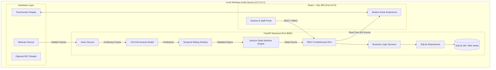
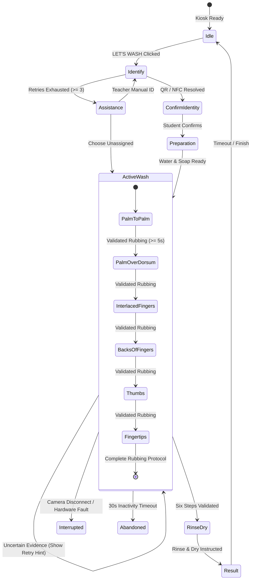
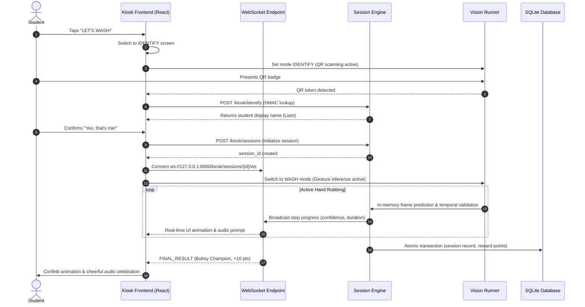
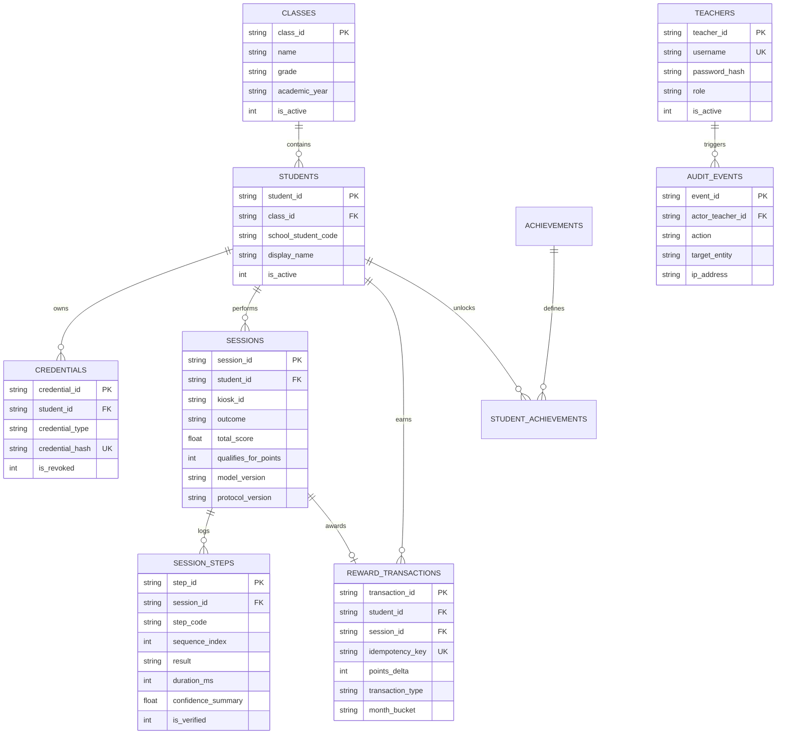

# Bubsy — System Architecture & Technical Specifications

**Academic / Formal Title:** AI-Powered Handwashing Guidance and Compliance System  
**Product Name:** Bubsy — The AI Handwashing Adventure  
**Document Version:** 1.0 (Release-Ready Final Specification)

---

## 1. System Overview & Technology Stack

Bubsy is an offline-capable, privacy-first handwashing guidance and compliance kiosk built for deployment in elementary and junior schools. It operates on a Windows 10/11 laptop or all-in-one touch kiosk connected to a local webcam near a school sink.

---

## 2. Core Architectural Subsystems

### 2.1 The Vision & Inference Pipeline
1. **Camera Abstraction (`WebcamCapture`):**
   - OpenCV wrapper managing device acquisition, frame retrieval, and robust release.
   - Enforces the **Zero-Persistence Privacy Invariant**: frames reside exclusively in volatile memory buffers and are never written to disk or transmitted over external networks.
2. **Gesture Recognition (`YoloGestureModel` / `StubGestureModel`):**
   - Ultralytics YOLOv8 architecture optimized for hand bounding and 6-class gesture classification.
   - Decoupled from application state; returns strongly typed `PredictionResult`.
3. **Temporal Sliding Window (`TemporalSlidingWindow`):**
   - Bounded FIFO queue evaluating gesture persistence, agreement ratio ($\ge 65\%$), and confidence thresholds.
   - Suppresses single-frame optical spikes, sensor noise, and hand transit flicker. Returns `SUPPORTED`, `UNCERTAIN`, or `NOT_PRESENT`.

---

## 3. Session State Machine & Event Sequence

---

## 4. Real-Time Kiosk Interaction Sequence

---

## 5. Security & Privacy Boundaries

| Boundary | Enforcement Mechanism | Purpose |
| :--- | :--- | :--- |
| **No Facial Recognition** | Architecture strictly restricts models to hand gestures. Prohibited imports tested via static AST inspection. | Complete child biometric privacy. |
| **Zero Image Persistence** | Camera frames processed in RAM only; no `cv2.imwrite` in codebase. Tested via automated disk scanner. | Compliance with COPPA, FERPA, and school privacy standards. |
| **Opaque Credentials** | Badges encode random high-entropy strings; lookup uses HMAC-SHA256 with server-side secret. | Stolen or photographed badge reveals zero student personal data. |
| **Staff Authentication** | Passwords hashed using Argon2id (`argon2-cffi`). Session tokens signed with HMAC-SHA256. | Protection of student rosters and historical logs. |
| **Role-Based Authorization** | Enforced server-side via `require_role("admin")` dependency on all settings/write endpoints. | Teachers can review and correct; only admins alter school rules. |
| **Immutable Points Ledger** | Direct edits forbidden. Manual point corrections create audited compensating transactions. | Complete transparency and auditability for school competitions. |

---

## 6. Database Entity-Relationship Architecture

