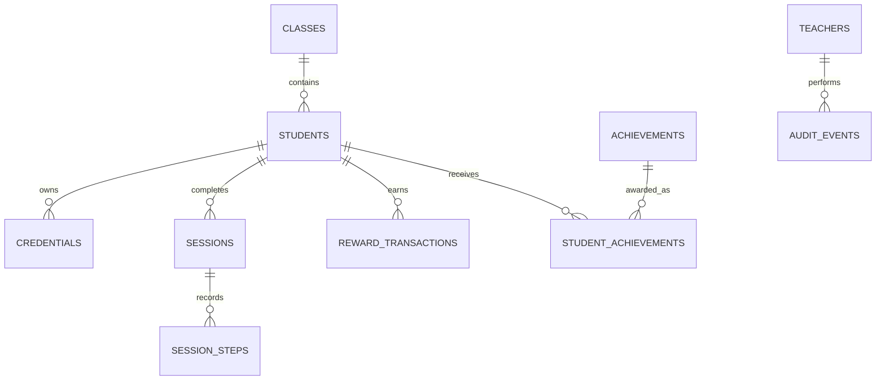

# Bubsy — Database Design

**Version:** 1.0  
**Project:** Bubsy — The AI Handwashing Adventure  
**Academic title:** AI-Powered Handwashing Guidance and Compliance System

## 1. Purpose

This document defines the local data model for Bubsy. The initial deployment uses SQLite on the kiosk computer. The database stores the minimum information needed for student identification, handwashing session records, scoring, teacher administration, reporting, and diagnostics.

## 2. Database principles

- Store no session photographs or videos.
- Do not store facial templates, facial embeddings, or biometric identity data.
- Use an internal `student_id` in session and reward records; avoid repeating personal details.
- Treat QR and NFC/RFID values as credentials, not as student identities.
- Use database transactions when completing sessions and awarding points.
- Preserve reward transaction history; do not delete old transactions to reset the monthly leaderboard.
- Store timestamps consistently in UTC where practical and convert to the school's configured timezone for display and monthly aggregation.
- Use migrations or versioned schema scripts so database changes are reproducible.
- Never commit production database files, credentials, or real student data to source control.

## 3. Entity relationship overview

A session may be unassigned only when school policy explicitly permits an unassigned guidance session. An unassigned session must not award student-specific points.

## 4. Tables

### 4.1 `classes`

| Field | Type | Rules | Purpose |
|---|---|---|---|
| `class_id` | TEXT / UUID | Primary key | Internal class identifier |
| `name` | TEXT | Required | Class display name |
| `grade` | TEXT | Optional | Grade/year |
| `academic_year` | TEXT | Required | School academic year |
| `is_active` | INTEGER | Boolean, default 1 | Whether class is active |
| `created_at` | TEXT | Required | Creation timestamp |
| `updated_at` | TEXT | Required | Last update timestamp |

### 4.2 `students`

| Field | Type | Rules | Purpose |
|---|---|---|---|
| `student_id` | TEXT / UUID | Primary key | Internal identifier |
| `school_student_code` | TEXT | Unique when supplied | School-issued ID |
| `display_name` | TEXT | Required | Approved display name |
| `class_id` | TEXT | Foreign key to `classes` | Current class |
| `is_active` | INTEGER | Boolean, default 1 | Student status |
| `created_at` | TEXT | Required | Creation timestamp |
| `updated_at` | TEXT | Required | Last update timestamp |

Collect only student fields approved by the school. Do not add date of birth, home address, parent contact details, or other sensitive fields unless a documented requirement and authorization exist.

### 4.3 `credentials`

| Field | Type | Rules | Purpose |
|---|---|---|---|
| `credential_id` | TEXT / UUID | Primary key | Credential record |
| `student_id` | TEXT | Foreign key to `students` | Credential owner |
| `credential_type` | TEXT | `QR` or `NFC` | Credential method |
| `credential_hash` | TEXT | Unique | Stored credential lookup value |
| `is_active` | INTEGER | Boolean, default 1 | Revocation support |
| `created_at` | TEXT | Required | Creation timestamp |
| `revoked_at` | TEXT | Nullable | Revocation timestamp |

Prefer random, opaque QR tokens over embedding student names or other personal information. If feasible, store a keyed hash of credential tokens rather than the raw token. Do not store card secrets that are not needed for identification.

### 4.4 `sessions`

| Field | Type | Rules | Purpose |
|---|---|---|---|
| `session_id` | TEXT / UUID | Primary key | Session identifier |
| `student_id` | TEXT | Nullable FK to `students` | Identified student |
| `kiosk_id` | TEXT | Required | Kiosk/device identifier |
| `started_at` | TEXT | Required | Start timestamp |
| `ended_at` | TEXT | Nullable | End timestamp |
| `duration_seconds` | INTEGER | Non-negative | Duration |
| `outcome` | TEXT | Controlled values | Completed, incomplete, uncertain, cancelled, error |
| `protocol_version` | TEXT | Required | Protocol used |
| `model_version` | TEXT | Nullable | Model used, if applicable |
| `qualifies_for_points` | INTEGER | Boolean, default 0 | Validated qualification |
| `failure_reason` | TEXT | Nullable | Non-sensitive reason code |
| `created_at` | TEXT | Required | Record creation timestamp |

Do not store image paths, video paths, or raw camera frames in this table.

### 4.5 `session_steps`

| Field | Type | Rules | Purpose |
|---|---|---|---|
| `session_step_id` | TEXT / UUID | Primary key | Step event identifier |
| `session_id` | TEXT | FK to `sessions` | Parent session |
| `step_code` | TEXT | Required | Configured protocol step |
| `sequence_index` | INTEGER | Required | Position in protocol |
| `result` | TEXT | Controlled values | Recognized, retry, uncertain, skipped |
| `duration_ms` | INTEGER | Nullable, non-negative | Validated step duration |
| `confidence_summary` | REAL | Nullable, 0–1 | Optional aggregate confidence for diagnostics |
| `created_at` | TEXT | Required | Event timestamp |

Persist only the aggregate data needed for review. Do not store per-frame predictions or video. Avoid interpreting model confidence as a direct measurement of hygiene.

### 4.6 `reward_transactions`

| Field | Type | Rules | Purpose |
|---|---|---|---|
| `transaction_id` | TEXT / UUID | Primary key | Transaction identifier |
| `student_id` | TEXT | FK to `students` | Student receiving adjustment |
| `session_id` | TEXT | Nullable FK to `sessions` | Source session |
| `points_delta` | INTEGER | Required | Positive award or authorized adjustment |
| `reason_code` | TEXT | Required | Validated session, correction, reversal |
| `idempotency_key` | TEXT | Unique where applicable | Prevent duplicate awards |
| `created_by_teacher_id` | TEXT | Nullable FK to `teachers` | Manual adjustment actor |
| `created_at` | TEXT | Required | Transaction timestamp |
| `notes` | TEXT | Nullable | Brief non-sensitive explanation |

Never silently edit or delete an issued transaction. Use a compensating transaction to reverse a verified error.

### 4.7 `achievements`

| Field | Type | Rules | Purpose |
|---|---|---|---|
| `achievement_id` | TEXT / UUID | Primary key | Achievement identifier |
| `name` | TEXT | Required | E.g. Bubsy Badge name |
| `description` | TEXT | Required | Student-friendly explanation |
| `criteria_json` | TEXT | Valid JSON | Achievement criteria |
| `is_active` | INTEGER | Boolean | Availability |

### 4.8 `student_achievements`

| Field | Type | Rules | Purpose |
|---|---|---|---|
| `student_achievement_id` | TEXT / UUID | Primary key | Award record |
| `student_id` | TEXT | FK to `students` | Recipient |
| `achievement_id` | TEXT | FK to `achievements` | Badge |
| `awarded_at` | TEXT | Required | Award timestamp |
| `source_key` | TEXT | Unique where appropriate | Prevent duplicate awards |

### 4.9 `teachers`

| Field | Type | Rules | Purpose |
|---|---|---|---|
| `teacher_id` | TEXT / UUID | Primary key | Account identifier |
| `username` | TEXT | Unique | Login name |
| `password_hash` | TEXT | Required | Password hash only |
| `role` | TEXT | Controlled values | Admin, teacher, operator |
| `is_active` | INTEGER | Boolean | Account status |
| `created_at` | TEXT | Required | Creation timestamp |
| `last_login_at` | TEXT | Nullable | Last login |

### 4.10 `settings`

Store versioned application configuration such as school timezone, protocol version, points rules, daily reward cap, language, audio preference, and retention period. Do not store secrets or passwords in this table.

Suggested fields: `setting_key` (primary key), `setting_value`, `updated_at`, `updated_by_teacher_id`.

### 4.11 `audit_events`

Record sensitive administrative actions, including credential replacement, student edits, scoring-rule changes, exports, and manual reward corrections.

Suggested fields: `audit_event_id`, `teacher_id`, `action`, `entity_type`, `entity_id`, `timestamp`, and a limited `details_json` that contains no passwords, credential secrets, or image data.

## 5. Integrity rules

1. Enforce foreign keys with `PRAGMA foreign_keys = ON`.
2. Add indexes on `students.class_id`, `sessions.student_id`, `sessions.started_at`, `sessions.outcome`, `session_steps.session_id`, and `reward_transactions.student_id`.
3. Enforce unique credential lookup values and idempotency keys.
4. Validate allowed outcomes and credential types in application code and, where practical, database constraints.
5. Use a single transaction to mark a session as qualifying and create its reward transaction.
6. Reject points for unidentified sessions, non-qualifying sessions, or duplicate submissions.
7. Make month boundaries timezone-aware and define the school's timezone in settings.
8. Apply database migrations before application startup; never discard an existing database during an upgrade.

## 6. Retention and backups

- Define retention periods with school administration before deployment.
- Provide authorized CSV exports and a documented local backup/restore procedure.
- Protect backups with operating-system permissions and appropriate encryption where available.
- Do not export credential secrets unless absolutely necessary.
- Deletion or deactivation of a student must follow the school's approved retention policy and preserve required auditability.
- Verify restore procedures during deployment testing.

## 7. Reporting definitions

- **Qualifying washes:** sessions whose outcome and qualification flag satisfy the configured rules.
- **Protocol completion rate:** qualifying completed sessions divided by the explicitly defined set of eligible sessions; show the denominator and period.
- **Monthly points:** sum of valid reward transactions in the configured local month.
- **Active participants:** students with at least one qualifying session in the selected period.
- **Recognition uncertainty:** count of sessions or steps flagged uncertain; this is a system-quality metric, not proof of poor student hygiene.

## 8. Acceptance criteria

- Schema creation and migrations are repeatable.
- Foreign-key and uniqueness constraints are tested.
- Duplicate session submissions cannot duplicate points.
- Monthly totals remain correct across month/year boundaries.
- No schema or persistence path stores camera images or videos.
- Backup and restore are tested on the Windows deployment target.
